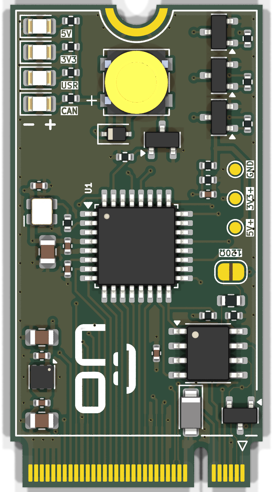
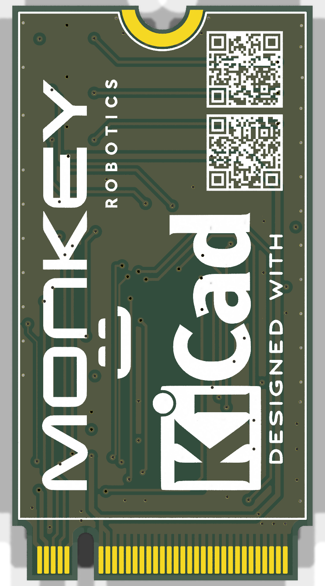

# MES4-MCU

A small STM32G0B1 microcontroller module with CAN, built as an M.2 2242 (B-key) card.

  
  &nbsp;&nbsp;&nbsp;
  

> **Note:** the edge connector uses a custom pinout. This is **not** an M.2 SSD or Wi-Fi card. Do not plug it into a laptop or PC M.2 slot.

## Specifications

| | |
|---|---|
| MCU | STM32G0B1KBT6 (Cortex-M0+, 64 MHz, 128 KB flash, 144 KB RAM), LQFP-32 |
| Clock | 8 MHz oscillator into HSE bypass, PLL to 64 MHz |
| CAN | FDCAN2 + SN65HVD230 transceiver, 500 kbit/s, NUP2105L ESD protection, optional 120 Ω termination (JP1) |
| Power input | 5 V (4.75–5.25 V) on fingers 20/22, about 40 mA typical, 240 mA worst case |
| 3.3 V rail | TLV76733 LDO (1 A), up to 50 mA available on finger 4 |
| Protection | SMF6.0A TVS on the 5 V input |
| I/O on the edge | 14 GPIO (8 of them ADC-capable), I²C, UART, SWD, NRST |
| On board | 4 LEDs (5V red, 3V3 green, CAN white, USR yellow), passive buzzer, 5 V input sense on PB2 |
| PCB | M.2 2242 B-key, 22 × 42 mm, 4 layers, 0.8 mm, ENIG, bevelled gold fingers |
| Operating range | −20 to +70 °C (design target) |

## Edge connector

Odd fingers are on the top side, even fingers on the bottom side. All signals are 3.3 V logic.

| Finger | Signal | Notes |
|---|---|---|
| 1 / 3 | CANH / CANL | to the SN65HVD230 through the ESD diode |
| 4 | +3V3 | **output** from the on-board LDO, max 50 mA; never drive it |
| 6 / 8 | UART TX / RX | USART1 (PA9 / PA10), e.g. ST-Link virtual COM port |
| 7 / 9 | SWDIO / SWCLK | PA13 / PA14 |
| 11 | NRST | pull low only (open-drain) |
| 20, 22 | +5V | power input |
| 23 / 25 | USB D+ / D− | wired to PA12 / PA11, not used in Rev A |
| 29, 31 | PC6, PA8 | GPIO (PA8 can read low during reset) |
| 35 – 49 | PA7 … PA0 | GPIO / ADC IN7 … IN0 (PA4, PA5: 3.6 V max) |
| 51 | PC15 | GPIO, sink only (no LEDs) |
| 53 / 55 | I²C1 SDA / SCL | PB9 / PB8, pull-ups go on the host board |
| 59, 61, 63 | PB6, PB3, PA15 | GPIO |
| all others | GND | |

## Using the module

- **Power:** supply 5 V on fingers 20/22 only. The module makes its own 3.3 V. Power down before inserting or removing it.
- **Programming / debug:** SWD (fingers 7/9/11) with finger 4 as the target voltage reference. The UART on fingers 6/8 is handy as a debug console.
- **CAN termination:** a CAN bus needs exactly two 120 Ω terminators, one at each end of the cable. Bridge solder jumper JP1 only if this module sits at an end. With everything powered off, CANH to CANL should measure about 60 Ω.
- **CAN wiring:** never run CANH/CANL in a connector or cable that also carries more than 12 V. The SN65HVD230 bus pins are rated −4 to +16 V, so a short to a 24 V supply destroys the transceiver (and R7 if JP1 is bridged). Rev A accepts this and relies on the harness.
- **Test points:** GND, 3V3 and 5V pads on the top side.

## Firmware notes

- HSE is an 8 MHz oscillator on PC14 (bypass mode). PLL: M = 2, N = 32, R = 2, Q = 2 → 64 MHz system and FDCAN clock.
- CAN at 500 kbit/s: prescaler 8, 16 time quanta (TSEG1 13, TSEG2 2, SJW 2), sample point 87.5 %.
- Set the UCPD1/UCPD2 strobe bits in SYSCFG early in start-up so PA8 is released.
- The buzzer is passive: drive PB7 with PWM (TIM4_CH2, about 4 kHz) and keep it low when idle, never high.
- Status LEDs: CAN on PB4, USR on PB5. Input voltage sense on PB2 (ADC IN10, divider ×3).

## Repository contents

| File | |
|---|---|
| `MES4-MCU.kicad_pro` | KiCad 9 project |
| `*.kicad_sch` | schematic (overview, power, MCU, CAN / M.2, datasheet links) |
| `MES4-MCU.kicad_pcb` | PCB layout |
| `MES4-MCU.pdf` | schematic as PDF |
| `MES4-MCU-BOM.csv` | bill of materials with LCSC part numbers |
| `MES4-MCU.kicad_dru` | custom design rules (JLCPCB 4-layer) |
| `MES4-MCU.pretty`, `MES4-MCU.3dshapes`, `MES4-MCU.kicad_sym` | project footprints, 3D models and symbols |

## Manufacturing

Designed for JLCPCB:

- 4 layers, 0.8 mm, stackup JLC04081H-3313 (top signal / GND / 3V3 / bottom signal)
- ENIG surface finish, gold fingers with a 20° / 0.3 mm bevel
- Ordered as a single board, panelised by JLC on the order. JLC only bevels gold fingers on boards or panels of at least 50 × 50 mm, so ask for a panel with the fingers on an outer edge, mouse-bite tabs and no V-cut along the fingers.
- Parts are mostly JLC Basic. The BOM lists LCSC numbers for every part.

## Status

Rev A. The design is complete but has not been fabricated or tested yet.

## Author

Aaron Raj Bhatti, Monkey Robotics. [LinkedIn](https://www.linkedin.com/in/aaron-raj-bhatti/)
